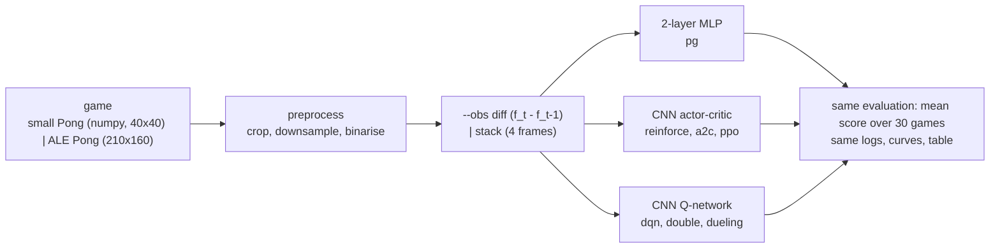

# pong-rl

**Pong from pixels with every main deep reinforcement learning method in one small PyTorch code
base: Karpathy's policy gradient, REINFORCE with a baseline, A2C, PPO, DQN, double DQN and dueling
DQN (with prioritized replay and n-step returns). Every method sees the same preprocessed frames,
is scored by the same evaluation and plotted on the same curves. A built-in numpy Pong lets every
method learn to beat its opponent in minutes on one CPU thread; the same code trains on Atari
Pong (`ALE/Pong-v5`) in the Kaggle/Colab notebook.**

[](LICENSE)
[](pyproject.toml)
[](https://pytorch.org)
[](docs/testing.md)
[](docs/environment.md)


*__GIF_CAPTION__*



| method | `--algo` | how it learns | code |
|---|---|---|---|
| Karpathy policy gradient | `pg` | 2-layer MLP on frame differences, P(UP); Monte Carlo returns reset at each point, standardised; gradient `A (y - p)` | [`algorithms/pg.py`](src/pong_rl/algorithms/pg.py) |
| REINFORCE + baseline | `reinforce` | CNN policy over NOOP/UP/DOWN; Monte Carlo return minus a learned V(s); entropy bonus | [`algorithms/reinforce.py`](src/pong_rl/algorithms/reinforce.py) |
| A2C | `a2c` | 16 parallel games, 5-step returns bootstrapped by the critic, one update per rollout | [`algorithms/a2c.py`](src/pong_rl/algorithms/a2c.py) |
| PPO | `ppo` | 8 games x 64 steps, GAE, clipped probability ratio, 4 epochs of minibatches per rollout | [`algorithms/ppo.py`](src/pong_rl/algorithms/ppo.py) |
| DQN | `dqn` | Q-learning on a CNN with replay buffer, target network, Huber loss, epsilon-greedy | [`algorithms/dqn.py`](src/pong_rl/algorithms/dqn.py) |
| double DQN | `double-dqn` | online net picks argmax a', target net evaluates it (less overestimation) | `dqn.td_targets(double=True)` |
| dueling DQN | `dueling-dqn` | Q = V(s) + A(s,a) - mean A, on top of double DQN | [`models.QNetwork`](src/pong_rl/models.py) |
| prioritized replay | `--per` | sample by \|TD error\|^0.6 from a sum tree, importance weights | [`buffers.py`](src/pong_rl/buffers.py) |
| n-step returns | `--n-step n` | r_t + ... + g^(n-1) r_(t+n-1) + g^n max Q | [`buffers.NStepAccumulator`](src/pong_rl/buffers.py) |

Equations, shapes and the reason behind each piece: [docs/architecture.md](docs/architecture.md).
The game, the preprocessing and `diff` vs `stack`: [docs/environment.md](docs/environment.md).

## Two games, and which numbers come from which

* **Small Pong** (`--env mini`, the default): a 40x40 numpy Pong written for this repo
  ([`envs/mini_pong.py`](src/pong_rl/envs/mini_pong.py)), same three actions as Atari Pong
  (NOOP, UP, DOWN), frame skip 2, first to 5 points, preprocessed to 20x20 binary frames. A random
  agent scores about -3.3, a hand-written "follow the ball" player +4.1. **All the results tables,
  curves and the GIF in this README come from it.**
* **ALE Pong** (`--env ale`, `ALE/Pong-v5` via gymnasium + ale-py, ROMs bundled, headless): 80x80
  binary frames (Karpathy's crop + downsample), frame skip 4, `--sticky` actions, first to 21.
  Winning needs millions of frames, which is days on a shared CPU, so here it only gets **short
  smoke runs** (a few thousand steps: the pipeline runs and the losses move). The real ALE training
  (PPO to about +18..+21, DQN to about +15..+20) is in the
  [Kaggle/Colab notebook](notebooks/train_colab_kaggle.ipynb), with budgets and estimated times.

## Quick start

```bash
git clone https://github.com/benisalla/pong-rl && cd pong-rl
uv venv .venv && VIRTUAL_ENV=.venv uv pip install -e ".[dev]"     # or: pip install -e ".[dev]"
source .venv/bin/activate

pong-train --algo a2c --steps 150000                 # ~3 min on one CPU thread, ends with a winning agent
pong-eval runs/a2c/model.pt --episodes 30            # mean score over 30 games on fixed serves
pong-play runs/a2c/model.pt --gif a2c.gif            # watch it
pong-train --algo pg                                 # Karpathy's method, as in the original notebook
pong-compare runs/* --plot curves.png                # table + curves for every run
```

Swap `--algo` for any row of the table, `--obs diff|stack` for the motion encoding, add `--per` /
`--n-step 3` to the DQN family, `--env ale` for Atari Pong. Every config field is a flag
(`pong-train --help`); training details and the measured tuning choices are in
[docs/training.md](docs/training.md), evaluation in [docs/evaluation.md](docs/evaluation.md).

## Examples

[`examples/`](examples/README.md) holds six short scripts that use the package from Python, in
order: meet the game and the preprocessing (random vs scripted player, figure, GIF), train A2C
from pixels to a winning policy in ~3 minutes, Karpathy's gradient identity and a short pg run,
DQN with every upgrade switched on, evaluate a checkpoint and save a GIF, and an ALE Pong smoke
test.

```bash
python examples/01_play_small_pong.py && python examples/02_train_a2c.py && python examples/05_evaluate_and_gif.py
```

## Results

__RESULTS__

## Repository layout

```
src/pong_rl/
  envs/mini_pong.py      the small numpy Pong (40x40 frames, NOOP/UP/DOWN, frame skip, sticky actions)
  envs/atari.py          ALE/Pong-v5 through gymnasium + ale-py, 3-action interface
  envs/wrappers.py       preprocessing (Karpathy crop/downsample/binarise) + diff / stack observations
  envs/__init__.py       make_env, VecEnv (n games in one process, auto-reset)
  models.py              KarpathyMLP, ConvEncoder (small | nature), ActorCritic, QNetwork (dueling)
  algorithms/            pg, reinforce, a2c, ppo, dqn (double / dueling / PER / n-step): one file each
  buffers.py             replay buffer, prioritized replay (sum tree), n-step accumulator
  utils.py               discounting with the Pong reset, GAE, schedules, seeding, threads, device
  config.py              one flat Config + per-method defaults
  policy.py              network -> action rule, checkpoints
  train.py  evaluate.py  play.py  compare.py     the four CLIs
  metrics.py  viz.py     run logs, curves, preprocessing figure, GIFs
tests/                   35 tests, < 1 min on one CPU thread
examples/                six numbered scripts (see examples/README.md)
scripts/compare_all.py   train several methods and build the results table and figures
notebooks/               build_notebook.py -> train_colab_kaggle.ipynb (explanations + ALE runs on a GPU)
docs/                    architecture, environment, training, evaluation, testing
assets/                  figures and GIF from the local runs
legacy/                  the original notebook + what was fixed
```

## Documentation

* [docs/architecture.md](docs/architecture.md): every method's equations, network shapes, why each trick exists
* [docs/environment.md](docs/environment.md): the small game, ALE Pong, preprocessing, `diff` vs `stack`
* [docs/training.md](docs/training.md): CLI, defaults, the tuning choices that mattered, speed, ALE budgets
* [docs/evaluation.md](docs/evaluation.md): the score, the fixed games, curves, how to compare fairly
* [docs/testing.md](docs/testing.md): what each test checks

## Legacy notebooks

[`legacy/RL_PONG.ipynb`](legacy/RL_PONG.ipynb) is the original coursework notebook: Karpathy's
"Pong from Pixels" in numpy, a gymnasium port, and a PyTorch rewrite trained on `ALE/Pong-v5`.
[`legacy/README.md`](legacy/README.md) lists what it did and the eleven problems found in it, the
main one being a loss that gave zero gradient to every DOWN action, and how the package fixes each.

## License

MIT, see [LICENSE](LICENSE).
