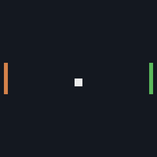
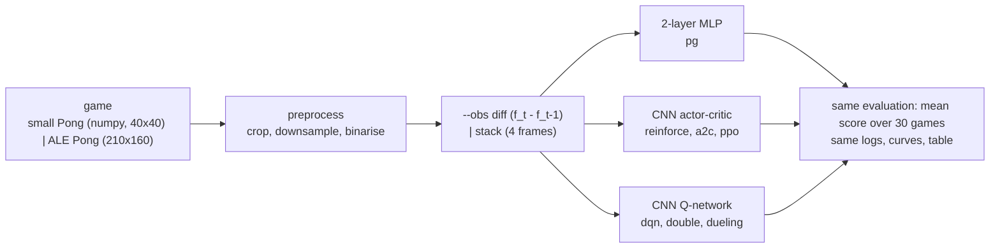
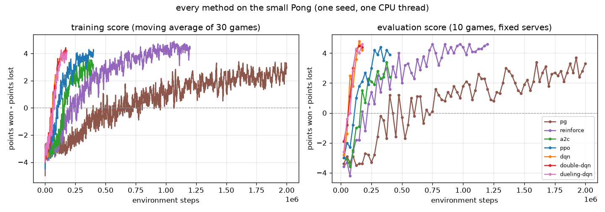
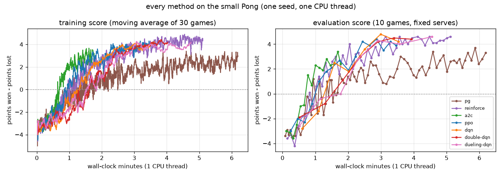

# pong-rl

**Pong from pixels with every main deep reinforcement learning method in one small PyTorch code
base: Karpathy's policy gradient, REINFORCE with a baseline, A2C, PPO, DQN, double DQN and dueling
DQN (with prioritized replay and n-step returns). Every method sees the same preprocessed frames,
is scored by the same evaluation and plotted on the same curves. A built-in numpy Pong lets every
method learn to beat its opponent in minutes on one CPU thread; the same code trains on Atari
Pong (`ALE/Pong-v5`) in the Kaggle/Colab notebook.**

[](LICENSE)
[](pyproject.toml)
[](https://pytorch.org)
[](docs/testing.md)
[](docs/environment.md)



*The DQN agent (green, right) against the built-in opponent on the small Pong, one game on an evaluation serve: it wins 5-0. Every number in this README that is not marked ALE comes from this game.*



| method | `--algo` | how it learns | code |
|---|---|---|---|
| Karpathy policy gradient | `pg` | 2-layer MLP on frame differences, P(UP); Monte Carlo returns reset at each point, standardised; gradient `A (y - p)` | [`algorithms/pg.py`](src/pong_rl/algorithms/pg.py) |
| REINFORCE + baseline | `reinforce` | CNN policy over NOOP/UP/DOWN; Monte Carlo return minus a learned V(s); entropy bonus | [`algorithms/reinforce.py`](src/pong_rl/algorithms/reinforce.py) |
| A2C | `a2c` | 16 parallel games, 5-step returns bootstrapped by the critic, one update per rollout | [`algorithms/a2c.py`](src/pong_rl/algorithms/a2c.py) |
| PPO | `ppo` | 8 games x 64 steps, GAE, clipped probability ratio, 4 epochs of minibatches per rollout | [`algorithms/ppo.py`](src/pong_rl/algorithms/ppo.py) |
| DQN | `dqn` | Q-learning on a CNN with replay buffer, target network, Huber loss, epsilon-greedy | [`algorithms/dqn.py`](src/pong_rl/algorithms/dqn.py) |
| double DQN | `double-dqn` | online net picks argmax a', target net evaluates it (less overestimation) | `dqn.td_targets(double=True)` |
| dueling DQN | `dueling-dqn` | Q = V(s) + A(s,a) - mean A, on top of double DQN | [`models.QNetwork`](src/pong_rl/models.py) |
| prioritized replay | `--per` | sample by \|TD error\|^0.6 from a sum tree, importance weights | [`buffers.py`](src/pong_rl/buffers.py) |
| n-step returns | `--n-step n` | r_t + ... + g^(n-1) r_(t+n-1) + g^n max Q | [`buffers.NStepAccumulator`](src/pong_rl/buffers.py) |

Equations, shapes and the reason behind each piece: [docs/architecture.md](docs/architecture.md).
The game, the preprocessing and `diff` vs `stack`: [docs/environment.md](docs/environment.md).

## Two games, and which numbers come from which

* **Small Pong** (`--env mini`, the default): a 40x40 numpy Pong written for this repo
  ([`envs/mini_pong.py`](src/pong_rl/envs/mini_pong.py)), same three actions as Atari Pong
  (NOOP, UP, DOWN), frame skip 2, first to 5 points, preprocessed to 20x20 binary frames. A random
  agent scores about -3.3, a hand-written "follow the ball" player +4.1. **All the results tables,
  curves and the GIF in this README come from it.**
* **ALE Pong** (`--env ale`, `ALE/Pong-v5` via gymnasium + ale-py, ROMs bundled, headless): 80x80
  binary frames (Karpathy's crop + downsample), frame skip 4, `--sticky` actions, first to 21.
  Winning needs millions of frames, which is days on a shared CPU, so here it only gets **short
  smoke runs** (a few thousand steps: the pipeline runs and the losses move). The real ALE training
  (PPO to about +18..+21, DQN to about +15..+20) is in the
  [Kaggle/Colab notebook](notebooks/train_colab_kaggle.ipynb), with budgets and estimated times.

## Quick start

```bash
git clone https://github.com/benisalla/pong-rl && cd pong-rl
uv venv .venv && VIRTUAL_ENV=.venv uv pip install -e ".[dev]"     # or: pip install -e ".[dev]"
source .venv/bin/activate

pong-train --algo a2c                                # ~2 min on one CPU thread, ends with a winning agent
pong-eval runs/a2c/model.pt --episodes 30            # mean score over 30 games on fixed serves
pong-play runs/a2c/model.pt --gif a2c.gif            # watch it
pong-train --algo pg                                 # Karpathy's method, as in the original notebook
pong-compare runs/* --plot curves.png                # table + curves for every run
```

Swap `--algo` for any row of the table, `--obs diff|stack` for the motion encoding, add `--per` /
`--n-step 3` to the DQN family, `--env ale` for Atari Pong. Every config field is a flag
(`pong-train --help`); training details and the measured tuning choices are in
[docs/training.md](docs/training.md), evaluation in [docs/evaluation.md](docs/evaluation.md).

## Examples

[`examples/`](examples/README.md) holds six short scripts that use the package from Python, in
order: meet the game and the preprocessing (random vs scripted player, figure, GIF), train A2C
from pixels to a winning policy in ~2 minutes, Karpathy's gradient identity and a short pg run,
DQN with every upgrade switched on, evaluate a checkpoint and save a GIF, and an ALE Pong smoke
test.

```bash
python examples/01_play_small_pong.py && python examples/02_train_a2c.py && python examples/05_evaluate_and_gif.py
```

## Results

These are **short CPU runs on the small Pong**, one seed per method, one CPU thread each, run
one at a time on a shared 8-core machine. They show that every method learns and how fast; they
are not benchmarks, and with other seeds the order of close methods can change.

### Small Pong: every method, default settings (`python scripts/compare_all.py`)

Score = points won - points lost in a game to 5 (range -5..+5), averaged over 30 games on fixed
serves (seeds 10 000-10 029). Reference points on the same games: random agent **-3.20**, always
NOOP -3.03, hand-written "follow the ball" player **+4.13**. The policy-gradient methods are
scored with sampled actions (the policy they optimise), the DQN family with argmax Q.

| method | obs | final score | win rate | best eval | env steps | first eval > 0 at | train time | params |
|---|---|---|---|---|---|---|---|---|
| `pg` | diff | **+2.80** +- 1.42 | 97% | +3.7 | 2,000,000 | 400,000 | 6.2 min | 80 k |
| `reinforce` | stack | **+4.23** +- 1.26 | 97% | +4.6 | 1,200,000 | 175,000 | 5.1 min | 138 k |
| `a2c` | stack | **+2.67** +- 2.20 | 90% | +3.4 | 400,000 | 175,040 | 1.8 min | 138 k |
| `ppo` | stack | **+4.17** +- 0.78 | 100% | +4.4 | 400,384 | 125,440 | 3.5 min | 138 k |
| `dqn` | stack | **+4.60** +- 0.55 | 100% | +4.8 | 180,000 | 75,000 | 3.6 min | 138 k |
| `double-dqn` | stack | **+4.50** +- 0.67 | 100% | +4.5 | 180,000 | 75,000 | 4.0 min | 138 k |
| `dueling-dqn +per n=3` | stack | **+4.40** +- 0.84 | 100% | +4.6 | 180,000 | 100,000 | 4.8 min | 138 k |

*"first eval > 0 at" = first periodic 10-game evaluation where the agent beat the opponent on
average. Train time excludes the final 30-game evaluation. `dueling-dqn` ran with `--per --n-step 3`.
Total wall time of the seven runs: 29 min.*



What the curves show:

* **Every method beats the opponent**, from a random start at about -3.3 to +2.7..+4.6.
* **The DQN family is the most sample-efficient**: above 0 by 75k-100k steps, because every
  transition is replayed ~8 times. Double and dueling DQN with PER + 3-step returns land within
  noise of plain DQN here; the small game has too little overestimation for the upgrades to matter
  (on ALE they do).
* **PPO** gets there by 125k steps and is the steadiest of the on-policy methods (std 0.78);
  **A2C** is the cheapest per step (1.8 min) but noisier (+2.67 +- 2.20 sampled, +3.97 greedy).
* **Monte Carlo methods need far more samples**: REINFORCE with a baseline crosses 0 at 175k and
  ends strong after 1.2M steps; Karpathy's `pg` (MLP, no learned baseline, frame differences)
  needs ~400k steps to cross 0 and 2M to reach +2.8. That is the variance argument for
  baselines and bootstrapping, measured.
* **Per minute** (`assets/mini_pong_curves_time.png`) the ranking changes: pg runs ~5 400 steps/s
  (tiny MLP) against 630-830 for the DQN family, so wall-clock time to a winning policy is 2-6 min for everyone.



Greedy evaluation (`pong-eval --greedy`) of the same policy-gradient checkpoints: pg +3.33,
REINFORCE +4.83, A2C +3.97, PPO +4.60 (all 100% wins); see [docs/evaluation.md](docs/evaluation.md).

### ALE Pong: smoke runs only (local CPU)

`ALE/Pong-v5`, 80x80 binary frames, frame skip 4, no sticky actions, gamma 0.99, Nature CNN.
These runs only prove that the same code runs on the Atari game and the losses move; a few
thousand steps is ~0.1% of what PPO needs to win.

| method | agent steps (frames) | games played | game scores | train time | what moved |
|---|---|---|---|---|---|
| `ppo` (4 envs x 128 steps) | 4 096 (16 k) | 3 | -21, -21, -21 | 62 s | entropy 1.0986 -> 1.0903, value loss 0.03-0.06, approx KL ~1e-3 |
| `dqn` (4 envs, buffer 4 k) | 4 000 (16 k) | 4 | -21 x 4 | 107 s | TD loss 8e-4 -> 4e-4, mean Q 0.015 -> 0.005 |
| `pg` (Karpathy, diff) | 4 000 (16 k) | 3 | -20, -20, -21 | 11 s | P(UP) 0.496 -> 0.523 |

The real ALE runs (PPO for 10M frames, dueling double DQN with 3-step returns for 4M frames,
Karpathy pg for 8M frames, with expected results of about +18..+21, +15..+20 and still below 0)
are in [`notebooks/train_colab_kaggle.ipynb`](notebooks/train_colab_kaggle.ipynb), built by
`notebooks/build_notebook.py`, with the budgets and estimated GPU times in
[docs/training.md](docs/training.md#ale-pong-the-real-runs-kagglecolab-gpu). No ALE numbers in
this README come from a trained agent.

## Repository layout

```
src/pong_rl/
  envs/mini_pong.py      the small numpy Pong (40x40 frames, NOOP/UP/DOWN, frame skip, sticky actions)
  envs/atari.py          ALE/Pong-v5 through gymnasium + ale-py, 3-action interface
  envs/wrappers.py       preprocessing (Karpathy crop/downsample/binarise) + diff / stack observations
  envs/__init__.py       make_env, VecEnv (n games in one process, auto-reset)
  models.py              KarpathyMLP, ConvEncoder (small | nature), ActorCritic, QNetwork (dueling)
  algorithms/            pg, reinforce, a2c, ppo, dqn (double / dueling / PER / n-step): one file each
  buffers.py             replay buffer, prioritized replay (sum tree), n-step accumulator
  utils.py               discounting with the Pong reset, GAE, schedules, seeding, threads, device
  config.py              one flat Config + per-method defaults
  policy.py              network -> action rule, checkpoints
  train.py  evaluate.py  play.py  compare.py     the four CLIs
  metrics.py  viz.py     run logs, curves, preprocessing figure, GIFs
tests/                   34 tests, < 1 min on one CPU thread
examples/                six numbered scripts (see examples/README.md)
scripts/compare_all.py   train several methods and build the results table and figures
notebooks/               build_notebook.py -> train_colab_kaggle.ipynb (explanations + ALE runs on a GPU)
docs/                    architecture, environment, training, evaluation, testing
assets/                  figures and GIF from the local runs
legacy/                  the original notebook + what was fixed
```

## Documentation

* [docs/architecture.md](docs/architecture.md): every method's equations, network shapes, why each trick exists
* [docs/environment.md](docs/environment.md): the small game, ALE Pong, preprocessing, `diff` vs `stack`
* [docs/training.md](docs/training.md): CLI, defaults, the tuning choices that mattered, speed, ALE budgets
* [docs/evaluation.md](docs/evaluation.md): the score, the fixed games, curves, how to compare fairly
* [docs/testing.md](docs/testing.md): what each test checks

## Legacy notebooks

[`legacy/RL_PONG.ipynb`](legacy/RL_PONG.ipynb) is the original coursework notebook: Karpathy's
"Pong from Pixels" in numpy, a gymnasium port, and a PyTorch rewrite trained on `ALE/Pong-v5`.
[`legacy/README.md`](legacy/README.md) lists what it did and the eleven problems found in it, the
main one being a loss that gave zero gradient to every DOWN action, and how the package fixes each.

## License

MIT, see [LICENSE](LICENSE).
