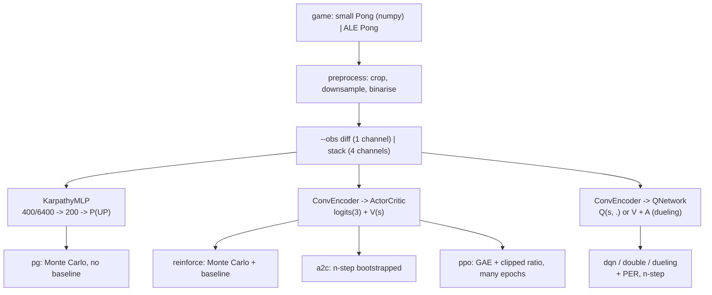

# Methods: equations, shapes and why

Seven methods, three families, one code base. Each learning rule is one file in
`src/pong_rl/algorithms/`, about 60 to 120 lines, and all of them share the environment, the
networks (`models.py`), the evaluation and the logging.

## Networks (`models.py`)

| network | used by | layers (small game, 20x20 input) | layers (ALE, 80x80 input) | parameters |
|---|---|---|---|---|
| `KarpathyMLP` | `pg` | flatten 400 -> 200 ReLU -> 1 | flatten 6400 -> 200 ReLU -> 1 | 80 k / 1.28 M |
| `ConvEncoder("small")` + heads | everything else, small game | conv 4x4/2 (16) -> 3x3/2 (32) -> 512 -> Linear 256 | | ~140 k |
| `ConvEncoder("nature")` + heads | everything else, ALE | | conv 8x8/4 (32) -> 4x4/2 (64) -> 3x3/1 (64) -> 2304 -> Linear 512 | ~1.2 M |

`encoder="auto"` picks `small` for frames up to 48 pixels and `nature` (Mnih et al. 2015) above.
**Why two CNNs.** The Nature CNN shrinks 84 (or 80) pixels to 7x7 (or 6x6); on a 20x20 frame it
would go below one pixel. The small CNN keeps a 4x4 spatial map, enough to tell where the ball is
relative to the paddle, and is ~20x cheaper on a CPU.

Initialisation: orthogonal with gain sqrt(2) in the encoder, 0.01 for the policy head (the first
policy is close to uniform: explore first), 1.0 for the value head. **Why.** The inputs are
binary frames with a few dozen pixels on; with PyTorch's default init the features shrink layer
after layer and the policy head barely gets a gradient (we measured zero learning in 150k steps
before switching).

## 1. `pg`: Karpathy's policy gradient (`algorithms/pg.py`)

Policy: p = sigma(MLP(x)) = P(UP | x), actions UP / DOWN only. For an episode with actions
a_t, labels y_t = [a_t = UP] and returns G_t:

    log pi(a_t | x_t) = y_t log p_t + (1 - y_t) log(1 - p_t)
    d log pi / d logit_t = y_t - p_t                          ("fake label" gradient)
    grad J ~ sum_t A_t (y_t - p_t) d logit_t / d theta

with A_t = G_t standardised over the episode. In code that is `loss = -(A * log_pi).sum()` and
autograd; `tests/test_algorithms.py` checks it equals the hand-written `A (y - p)`.

* **Discounting reset at each point** (`utils.discount_rewards(reset_on_point=True)`): in Pong every
  non-zero reward ends a rally, so an action is only credited with the point it helped decide.
* **Standardising the returns** pushes about half the actions up and half down in every game,
  a crude baseline that keeps the gradient's scale constant.
* RMSprop (decay 0.99), gradients summed over `--batch-episodes` games per step.

Why it is slow: no learned baseline (high variance), Monte Carlo (nothing is learnt until a game
ends), and an MLP that has to learn every ball position separately (no weight sharing).

## 2. `reinforce`: REINFORCE with a baseline, on a CNN (`algorithms/reinforce.py`)

    A_t = G_t - V(s_t)          (then normalised over the batch)
    L   = -mean[A_t log pi(a_t|s_t)] + 0.5 mean[(V(s_t) - G_t)^2] - 0.01 mean[H(pi(.|s_t))]

**Why the baseline.** Any function of the state can be subtracted from G_t without biasing the
gradient (E[grad log pi] = 0). Subtracting V(s), the return you expected anyway, leaves only the
"better or worse than usual" part, so the variance drops. The entropy bonus keeps the policy from
collapsing to one action before it has seen enough. Still Monte Carlo: one gradient step per
`--batch-episodes` finished games.

## 3. `a2c`: advantage actor-critic (`algorithms/a2c.py`)

16 parallel games, rollouts of 5 steps, then bootstrap with the critic:

    G_t = r_t + g r_{t+1} + ... + g^{n-1} r_{t+n-1} + g^n V(s_{t+n})   (cut at a game end)
    A_t = G_t - V(s_t)

Same loss as REINFORCE. **Why it is faster.** It learns after 5 steps instead of a whole game,
and the bootstrapped target has much lower variance than a Monte Carlo return (at the price of
some bias from an imperfect V). 16 games in parallel give decorrelated batches, the role the
replay buffer plays in DQN. `utils.gae` with lambda = 1 computes exactly these n-step returns.

## 4. `ppo`: proximal policy optimisation (`algorithms/ppo.py`)

Rollouts of 8 games x 64 steps, advantages by GAE(gamma, lambda = 0.95):

    delta_t = r_t + g V(s_{t+1}) - V(s_t),     A_t = delta_t + g lambda A_{t+1}
    rho_t   = pi_theta(a_t|s_t) / pi_old(a_t|s_t)
    L_clip  = -mean min(rho_t A_t, clip(rho_t, 1 - 0.1, 1 + 0.1) A_t)

then 4 epochs over the batch in minibatches. **Why.** Reusing a batch several times is where the
sample efficiency comes from, but the more you reuse it, the further the policy drifts from the
one that collected it. The clip zeroes the gradient of any sample whose probability ratio already
moved more than 10% in the direction its advantage pushes, so one batch cannot move the policy
far. `tests/test_algorithms.py` checks that clipped samples give exactly zero gradient.
GAE's lambda trades bias (lambda = 0, one-step TD) for variance (lambda = 1, Monte Carlo).

## 5. `dqn`, `double-dqn`, `dueling-dqn` (`algorithms/dqn.py`, `buffers.py`)

Learn Q(s, a), act epsilon-greedily (epsilon 1.0 -> 0.02 over the first 10% of training):

    y   = r + g^n (1 - done) max_a' Q_target(s', a')                         DQN
    y   = r + g^n (1 - done) Q_target(s', argmax_a' Q_online(s', a'))        double DQN
    L   = mean_i w_i Huber(Q_online(s_i, a_i) - y_i)

| trick | flag | why |
|---|---|---|
| replay buffer | always (`--buffer-size`) | consecutive frames are nearly identical; random old transitions decorrelate the batch and reuse each sample ~8 times |
| target network | `--target-update` | without it the target moves with every gradient step and Q chases its own tail |
| Huber loss + grad-norm clip 10 | always | one surprising point cannot blow up the update |
| double DQN | `--double` (`double-dqn`) | max over noisy estimates is biased upwards; choosing with the online net and evaluating with the target net removes most of it |
| dueling head | `--dueling` (`dueling-dqn`) | Q = V(s) + A(s,a) - mean_a A(s,a): most frames do not care which way you move, V learns that once for all actions |
| prioritized replay | `--per` | replay transitions with large TD error more (p_i ~ (\|delta_i\| + eps)^0.6), correct the bias with importance weights (beta 0.4 -> 1) |
| n-step returns | `--n-step n` | the point reward travels back n frames per update instead of one |

`dueling-dqn` implies `--double`. The replay ratio is fixed by `--train-freq`: one gradient step of
`--batch-size` per `train_freq` environment steps (64 per 8 on the small game).

## Shapes in one rollout (PPO, small game)

| tensor | shape | dtype |
|---|---|---|
| observation batch | (8, 4, 20, 20) | uint8 (0/1) |
| logits, values | (8, 3), (8,) | float32 |
| rollout obs | (64, 8, 4, 20, 20) -> flattened (512, 4, 20, 20) | uint8 |
| advantages, returns | (64, 8) -> (512,) | float32 |
| minibatch | (256, 4, 20, 20) | uint8 |
