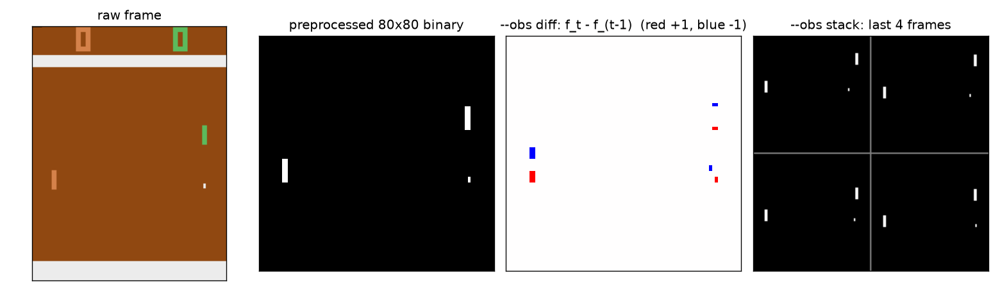
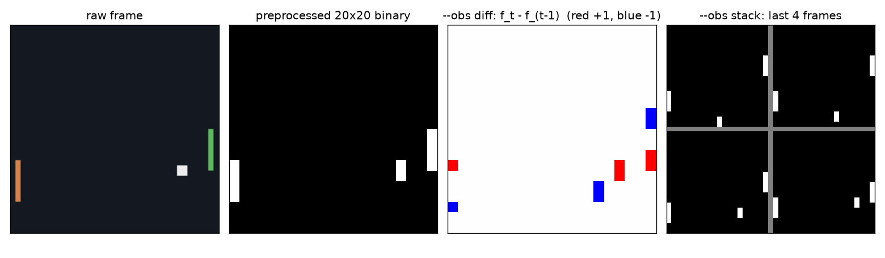

# Environments and pixel preprocessing

Every method sees the game through the same function, `make_env(env, obs)` in
`src/pong_rl/envs/__init__.py`, so the only thing that changes between two rows of the results
table is the learning rule.

## Two games, one interface

| | small Pong (`--env mini`, default) | ALE Pong (`--env ale`) |
|---|---|---|
| code | `envs/mini_pong.py`, ~150 lines of numpy | `envs/atari.py`, `gym.make("ALE/Pong-v5")` |
| raw frame | 40x40 uint8 | 210x160x3 uint8 |
| after preprocessing | 20x20 binary | 80x80 binary (Karpathy) |
| actions | NOOP, UP, DOWN | the same three (ALE ids 0, 2, 3) |
| frame skip | 2 game ticks per decision | 4 emulator frames per decision |
| sticky actions | `--sticky p` (default 0) | `--sticky p` (default 0; the v5 default is 0.25) |
| a game | first to 5 points, score in [-5, 5] | first to 21 points, score in [-21, 21] |
| random agent | about -3.3 | about -20.5 |
| cost per step | ~0.1 ms | ~0.25 ms + 16x bigger network input |
| trains on one CPU thread | yes, minutes | no, needs millions of frames (notebook, GPU) |

**Why a second game.** A pixel agent needs roughly 2-10 million ALE frames to win at Pong. On a
shared CPU that is days. The small game keeps every property that makes Pong a *pixel*
reinforcement learning problem (only frames as input, velocity invisible in one frame, a point
decided many decisions after the action that mattered, an opponent to beat) and removes only
the size. Every method learns it in minutes, so you can actually watch the differences between
them, then take the same code to ALE Pong in the notebook.

### The small game (`MiniPong`)

* Right paddle = you (green, like the Atari agent), left paddle = built-in opponent (orange).
* Paddles are 8 pixels tall and move 2 pixels per tick; the ball is 2x2 and moves 2 pixels per tick
  horizontally, 1 or 2 vertically.
* Hitting the ball near the paddle's edge sends it back steeply (vertical speed 2), near the
  centre gently (speed 1). That is the skill to discover: the opponent follows the ball at a
  limited speed and freezes 30% of the time, so steep balls get past it.
* Reward +1 when the ball passes the opponent, -1 when it passes you, then a serve from the centre.
* Reference scores (`examples/01_play_small_pong.py`, 30 games): random -3.2, always NOOP -3.0,
  a scripted "follow the ball" tracker +4.1. A learnt policy > 0 beats the opponent on average.

### ALE Pong

`ale-py >= 0.9` ships the ROMs, so `pip install gymnasium ale-py` is all it needs, and it runs
headless (no window, no `render_mode` unless you want frames for a GIF). `tests/test_envs.py`
checks it starts and steps. `frameskip=4` is the standard Atari setting (the agent acts at 15 Hz).
`--sticky 0.25` gives the Machado et al. (2018) protocol where the previous action is repeated with
probability 0.25, which stops an agent from memorising one deterministic sequence of moves.

## Preprocessing (`envs/wrappers.py: preprocess`)



ALE, exactly Karpathy's `prepro`:

```python
f = frame[35:195:2, ::2, 0].copy()    # crop score + borders (160 rows), keep 1 pixel in 2, red channel
f[(f == 144) | (f == 109)] = 0       # erase the two background colours
f = (f != 0).astype(np.uint8)        # paddles and ball -> 1   => 80x80 binary
```

Small game: 40x40 -> 20x20 by a max over 2x2 blocks (the "downsample by 2" step; max instead of
"keep one pixel" so the 2x2 ball can never vanish), then binarise.



**Why binary.** Colours carry no information in Pong; 0/1 images are the easiest possible input,
and they are stored as 1-byte integers so the DQN replay buffer stays small.

## Seeing motion: `--obs diff` or `--obs stack`

One frame shows where the ball is, not where it goes. Two classic fixes, both in `PixelObs`:

* **`diff`** (Karpathy): x_t = f_t - f_{t-1}, one channel in {-1, 0, 1}. A moving object becomes a
  +1 blob (where it is) next to a -1 blob (where it was): direction and speed in one picture,
  half the input of a stack. Anything still disappears. For Karpathy's UP/DOWN-only agent the paddle
  is always moving, so it is always visible; for agents with NOOP a still paddle vanishes, which is
  why the CNN methods default to stacking. The first observation of a game is all zeros.
* **`stack`** (DQN): x_t = [f_{t-3}, f_{t-2}, f_{t-1}, f_t], 4 channels in {0, 1}. Nothing is thrown
  away; the network must learn to compare frames itself. At the start of a game the first frame is
  repeated.

`pg` defaults to `diff`, every other method to `stack`; any method accepts either flag.

## Vectorised environments

`VecEnv(n)` steps `n` copies in one process, auto-resets finished games and returns the finished
game's score in `info["episode"]` and its last frame in `info["final_obs"]` (so DQN can bootstrap
through a time-limit cut). A2C, PPO and REINFORCE use it to collect decorrelated data; the DQN
family uses it to act with one batched forward pass instead of `n` single ones, which on a CPU is
most of the cost.
